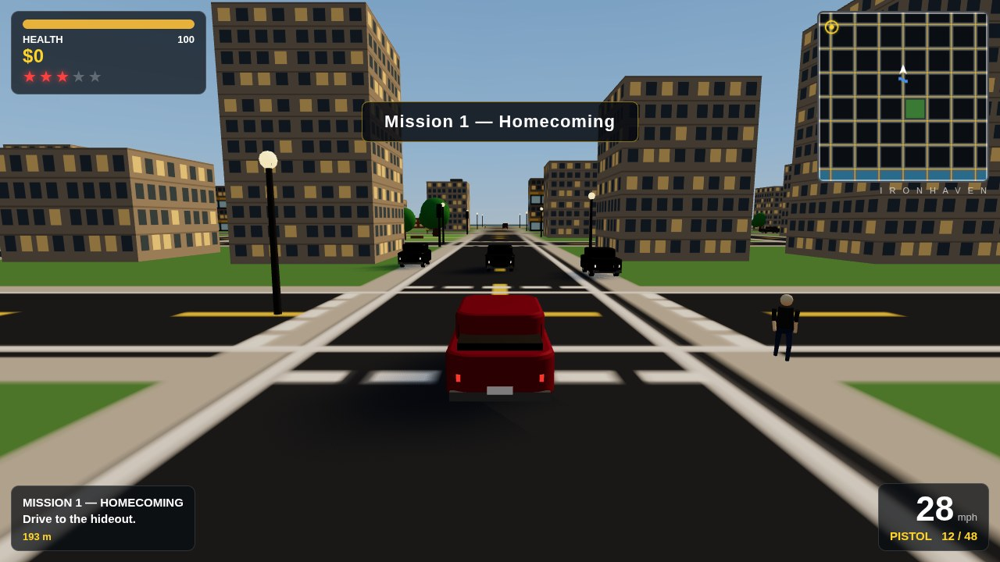
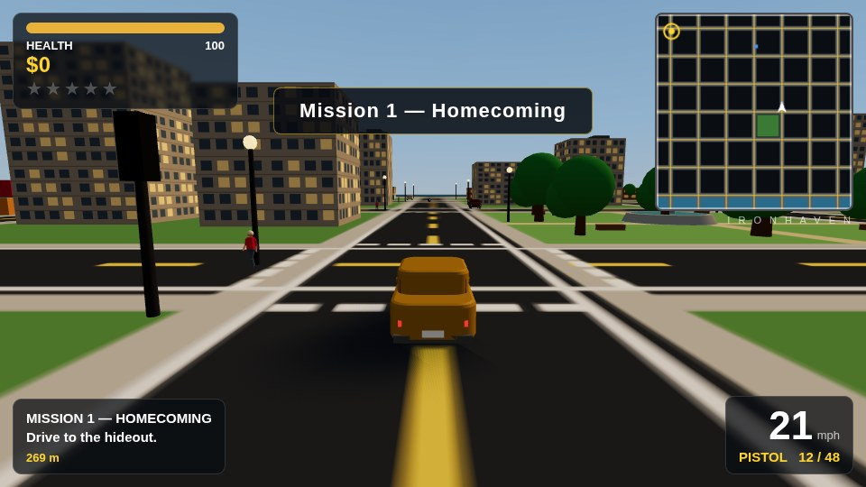
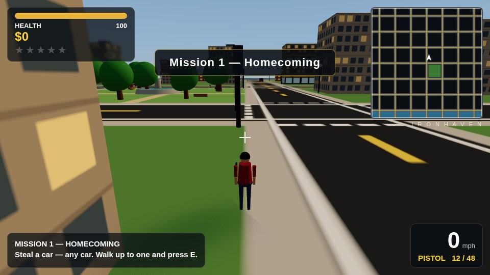
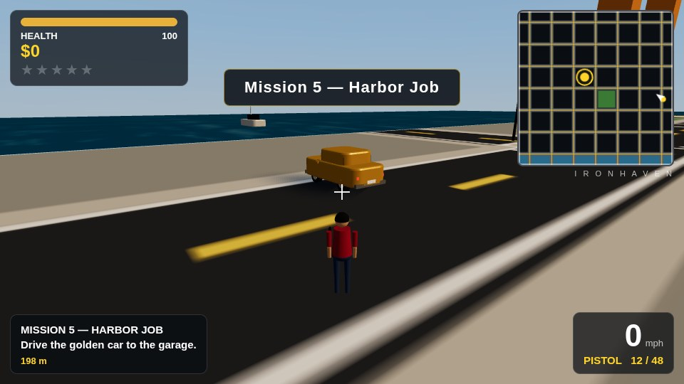

# IRONHAVEN

[](https://make.fun/bounty/gta6-01)
[](https://make.fun/bounty/gta6-01)
[](https://make.fun/bounty/gta6-01)

An open-world crime game built by an AI agent for make.fun's "Build a GTA-style open-world game" bounty ($1,666 in USDC). All-original content, nothing from Rockstar.

**IRONHAVEN** is a 392×392 m open city you can drive, walk, steal, shoot, and get chased through. Five story missions, a wanted system with police chases and arrests, three weapons, eight vehicle models, living traffic, and a harbor, park, beach, and downtown — all in a desktop browser from static files, with zero network requests at runtime.

## How to play

Serve the game and open it in desktop Chrome:

```sh
node serve.ts
# open http://localhost:8080
```

Or open `game/index.html` through any static file server. No build step, no install, no network.

## Controls

| Key | Action |
|---|---|
| W A S D | Move / drive |
| Mouse | Look (click to lock the pointer) |
| Shift | Sprint / boost |
| Space | Jump (on foot) / handbrake (driving) |
| Left click | Shoot |
| R | Reload |
| E | Enter / exit car |
| 1 / 2 / 3 | Pistol / SMG / Shotgun |
| P | Pause / save |
| M | Mute |

## The city

Seven-by-seven blocks on a grid of roads, five districts:

- **Downtown** — tall glass towers, one with a helipad
- **Residential** — low brick houses
- **Harbor** — docks, shipping containers, cranes, animated water, a boat
- **Park** — grass, trees, paths, benches, a fountain
- **Beach** — sand and coastline on the north edge

Roads have asphalt textures with lane dashes, crosswalks, sidewalks, street signs, and **working traffic lights** — traffic stops at red. Street lamps light up at dusk; the sun is golden-hour, with real shadows, fog, drifting clouds, and a visible sun.

## Story missions

1. **Homecoming — $300.** Steal a car, drive to the hideout.
2. **Pickup — $500.** Collect the package across town.
3. **Getaway — $700.** Lose the cops and reach the garage.
4. **Shakedown — $1,000.** Eliminate the hostiles at the plaza.
5. **Harbor Job — $1,500.** Drive the golden car from the harbor to the garage.

Finish all five for the ending screen. The HUD shows the objective, distance, and timer, plus a yellow beacon on the live minimap.

## Systems

- **Wanted 0–5 stars.** Police cars chase and ram; foot cops arrest you (BUSTED) if they stay close for ~2 s. Wanted decays when you break line of sight. Death is WASTED.
- **Combat.** Pistol, SMG, and shotgun — each a proper model with distinct damage, fire rate, spread, range, and magazine. Muzzle flash, recoil, shell casings, reload animation, aim-corrected shooting. Weapon pickup crates around the map.
- **Vehicles.** Sedan, coupe, SUV, pickup, van, bus, motorcycle, and a boat at the harbor — distinct handling, spinning and steering wheels, opening doors, headlights and taillights. 22 traffic cars follow lanes and stop at red lights; 14 parked cars are stealable.
- **People.** 36 pedestrians with varied clothing, hair, and skin — they walk, run, cross at crosswalks, and flee from gunfire. Hostiles guard mission 4.
- **Audio.** Synthesized WebAudio music (100 BPM, A-minor) and sound effects — engine pitch by speed, sirens, gunshots, crashes, pickups. No audio files. M mutes.
- **Save.** Autosaves to localStorage; continue from the start screen.

## Tech

- Three.js 0.187.0, vendored under `game/vendor/three/` (import map, zero network at runtime)
- Smooth-shaded primitives, procedural canvas textures (facades, asphalt, grass, sand), merged geometry for performance, PCF shadow map, ACES tone mapping
- Headless-tested: 15/15 gameplay checks, smoke test, 4 screenshots in `screenshots/`

## Screenshots






## Dossier

`dossier.json` is built from `game/` and `screenshots/` with the kit's `buildDossier` (`node main.ts`). It is byte-identical across runs; judge-visible text is under the 163,840-byte cap.

## License

MIT — see `LICENSE`.
